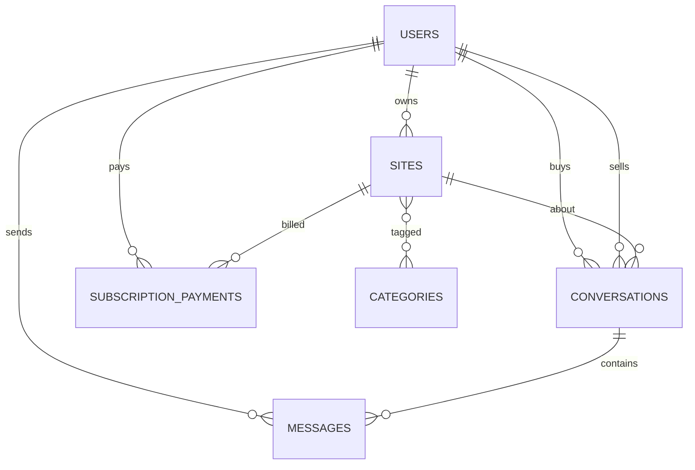
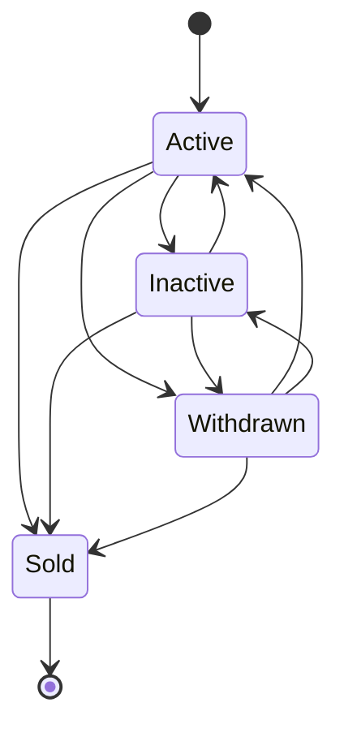

# Data Model: Модели данных биржи по продаже сайтов

**Feature**: `001-marketplace-data-model` | **Date**: 2026-10-28 | **Spec**: [spec.md](./spec.md)

Слой данных реализует пять новых сущностей (`Category`, `Site`, `Conversation`, `Message`, `SubscriptionPayment`), два enum и расширение `User`. Схема совместима с MySQL 8.0.46 и SQLite 3.37.2 (тесты).

## ER Diagram



## Enums

### `App\Enums\ListingStatus` (`string`)

| Case | Value | Подпись | Публично видим при оплате |
|---|---|---|---|
| `Active` | `active` | Активен | да |
| `Inactive` | `inactive` | Неактивен | нет |
| `Withdrawn` | `withdrawn` | Снят с продажи | нет |
| `Sold` | `sold` | Продан | нет |

Методы:

- `label(): string` — русская подпись.
- `allowedTransitions(): array<int, self>` — список допустимых целевых статусов.
- `canTransitionTo(self $target): bool` — проверка перехода по FR-008.
- `isTerminal(): bool` — `true` только для `Sold`.
- `values(): array<int, string>` — значения для валидации.

### `App\Enums\PaymentStatus` (`string`)

| Case | Value | Подпись | Успешен | Финальный |
|---|---|---|---|---|
| `Pending` | `pending` | Ожидает оплаты | нет | нет |
| `Paid` | `paid` | Оплачен | да | да |
| `Failed` | `failed` | Не прошёл | нет | да |
| `Cancelled` | `cancelled` | Отменён | нет | да |

Методы: `label()`, `isSuccessful()`, `isFinal()`, `values()`.

## Tables

### `users` (изменяется)

| Column | Type | Null | Default | Index | Примечание |
|---|---|---|---|---|---|
| `id` | bigint unsigned | no | auto | PK | |
| `name` | varchar(255) | no | — | | отображаемое имя провайдера |
| `email` | varchar(255) | **yes** | null | unique | необязателен, не ключ входа |
| `email_verified_at` | timestamp | yes | null | | остаётся от стандартной схемы |
| `password` | varchar(255) | **yes** | null | | пароль не требуется |
| `avatar` | varchar(2048) | yes | null | | URL аватара провайдера |
| `vk_id` | bigint unsigned | yes | null | unique | идентификатор VK ID |
| `ya_id` | bigint unsigned | yes | null | unique | идентификатор Yandex ID |
| `vk_last_login_at` | timestamp | yes | null | | время последнего входа через VK |
| `ya_last_login_at` | timestamp | yes | null | | время последнего входа через Yandex |
| `remember_token` | varchar(100) | yes | null | | |
| `created_at`, `updated_at` | timestamp | yes | null | | |

Инварианты:

- Аккаунт создаётся хотя бы с одним из `vk_id` / `ya_id`; на уровне БД `CHECK` не ставится, чтобы не блокировать будущих провайдеров.
- Повторный вход ищет пользователя по `vk_id` или `ya_id`; `email` для этого не используется.
- Автоматическое объединение аккаунтов по email запрещено.
- Миграция меняет `email` и `password` на nullable; `email` сохраняет уникальность (NULL не конфликтуют).

### `categories`

| Column | Type | Null | Default | Index |
|---|---|---|---|---|
| `id` | bigint unsigned | no | auto | PK |
| `name` | varchar(255) | no | — | unique |
| `slug` | varchar(255) | no | — | unique |
| `created_at`, `updated_at` | timestamp | yes | null | |

`slug` генерируется из `name` через `Str::slug()` один раз при создании (`creating`), поэтому остаётся стабильным при переименовании.

### `sites`

| Column | Type | Null | Default | Index |
|---|---|---|---|---|
| `id` | bigint unsigned | no | auto | PK |
| `user_id` | bigint unsigned | no | — | FK → `users.id`, restrict |
| `title` | varchar(255) | no | — | |
| `domain` | varchar(253) | no | — | |
| `status` | varchar(16) | no | `active` | в составе `sites_visibility_index` |
| `public_domain` | varchar(253), generated stored | yes | — | **unique** |
| `description` | text | no | — | |
| `price` | decimal(12,2) | no | 0 | index |
| `monthly_revenue` | decimal(12,2) | no | 0 | index |
| `has_trademark` | boolean | no | false | |
| `verification_filename` | varchar(64) | no | — | unique |
| `verified` | boolean | no | false | |
| `paid_until` | date | yes | null | в составе `sites_visibility_index` |
| `sold_at` | timestamp | yes | null | |
| `created_at`, `updated_at` | timestamp | yes | null | index (`created_at`) |

Генерируемый столбец (в миграции объявляется **после** `status`):

```sql
public_domain varchar(253) as (
    case when status in ('active', 'inactive') then domain else null end
) stored
```

Индексы:

- `sites_public_domain_unique` — уникальность нормализованного домена среди активных и неактивных.
- `sites_verification_filename_unique` — уникальность имени файла проверки.
- `sites_visibility_index (status, paid_until)` — каталог.
- `sites_price_index`, `sites_monthly_revenue_index` — фильтры по диапазону.
- `sites_created_at_index` — сортировка по новизне.

Инварианты:

- `domain` сохраняется нормализованным: нижний регистр, без префикса `www.`, без завершающего `/`.
- `price >= 0`, `monthly_revenue >= 0` — контракт модели; пользовательский ввод валидируется Form Request в HTTP-фазе (FR-025).
- `status` — ровно один из `ListingStatus`; меняется только через `changeStatus()`.
- `verified` по умолчанию `false`, меняется только администратором через `markVerified()`; не влияет на публичную видимость (FR-032).
- `verification_filename` генерируется один раз при создании (`Str::lower(Str::random(32)).'.txt'`) и не меняется при обновлении (FR-031).
- `paid_until` не задаётся продавцом напрямую; продлевается платежом.
- `sold_at` выставляется при переходе в `Sold`.

### `category_site` (pivot)

| Column | Type | Null | Index |
|---|---|---|---|
| `category_id` | bigint unsigned | no | PK (составной), FK → `categories.id`, restrict |
| `site_id` | bigint unsigned | no | PK (составной), FK → `sites.id`, cascade, index |

Составной первичный ключ `(category_id, site_id)` предотвращает дубликаты. Удаление тематики, которая используется, блокируется внешним ключом (Edge Cases).

### `conversations`

| Column | Type | Null | Default | Index |
|---|---|---|---|---|
| `id` | bigint unsigned | no | auto | PK |
| `site_id` | bigint unsigned | no | — | FK → `sites.id`, cascade |
| `buyer_id` | bigint unsigned | no | — | FK → `users.id`, cascade |
| `seller_id` | bigint unsigned | no | — | FK → `users.id`, cascade |
| `last_message_at` | timestamp | yes | null | в составе индексов входящих |
| `created_at`, `updated_at` | timestamp | yes | null | |

Индексы и ограничения:

- `conversations_site_id_buyer_id_unique (site_id, buyer_id)` — один диалог на пару.
- `(buyer_id, last_message_at)` и `(seller_id, last_message_at)` — списки диалогов.

`last_message_at` обновляется событием `created` модели `Message`; диалог без сообщений имеет `null`.

### `messages`

| Column | Type | Null | Default | Index |
|---|---|---|---|---|
| `id` | bigint unsigned | no | auto | PK |
| `conversation_id` | bigint unsigned | no | — | FK → `conversations.id`, cascade |
| `sender_id` | bigint unsigned | no | — | FK → `users.id`, cascade |
| `body` | text | no | — | |
| `read_at` | timestamp | yes | null | в составе `(conversation_id, read_at)` |
| `created_at`, `updated_at` | timestamp | yes | null | |

Индексы: `(conversation_id, created_at)` для истории, `(conversation_id, read_at)` для непрочитанных.

`read_at` — время прочтения получателем. У сообщения ровно один получатель, поэтому одного поля достаточно.

### `subscription_payments`

| Column | Type | Null | Default | Index |
|---|---|---|---|---|
| `id` | bigint unsigned | no | auto | PK |
| `site_id` | bigint unsigned | no | — | FK → `sites.id`, cascade |
| `user_id` | bigint unsigned | no | — | FK → `users.id`, cascade |
| `amount` | decimal(10,2) | no | — | |
| `currency` | char(3) | no | `RUB` | |
| `period_months` | smallint unsigned | no | — | |
| `status` | varchar(16) | no | `pending` | index |
| `paid_at` | timestamp | yes | null | |
| `external_id` | varchar(255) | yes | null | unique |
| `created_at`, `updated_at` | timestamp | yes | null | |

Индексы: `(site_id, created_at)` и `(user_id, created_at)`.

Инварианты:

- `amount > 0`, `period_months >= 1`, `currency = 'RUB'` — проверяются в `markAsPaid()`; пользовательский ввод валидируется на HTTP-слое.
- Успешный платёж — единственный путь изменения `sites.paid_until`.
- `external_id` уникален среди непустых значений (идемпотентность провайдера).
- Платёж принимается только для объявлений в статусах `Active` / `Inactive` (FR-028).

## Model Configuration

| Model | Table | `#[Fillable]` | Casts | Route key |
|---|---|---|---|---|
| `User` | `users` | `name`, `email`, `password` (без изменений) | `email_verified_at`, `password`, `vk_last_login_at`, `ya_last_login_at` → datetime | `id` |
| `Category` | `categories` | `name` | — | `slug` (`#[RouteKey('slug')]`) |
| `Site` | `sites` | `title`, `domain`, `description`, `price`, `monthly_revenue`, `has_trademark` | `status` → `ListingStatus`, `price`/`monthly_revenue` → `decimal:2`, `has_trademark`/`verified` → boolean, `paid_until` → date, `sold_at` → datetime | `id` |
| `Conversation` | `conversations` | `site_id`, `buyer_id`, `seller_id` (создание только через `startFor()`) | `last_message_at` → datetime | `id` |
| `Message` | `messages` | `body` | `read_at` → datetime | `id` |
| `SubscriptionPayment` | `subscription_payments` | — (создание через фабрику/платёжный слой) | `status` → `PaymentStatus`, `amount` → `decimal:2`, `paid_at` → datetime | `id` |

`Site` использует мутатор `domain` (`Attribute`) для нормализации. `Category` генерирует `slug` в `booted()` при `creating`. Соцполя `User` (`avatar`, `vk_id`, `ya_id`, `vk_last_login_at`, `ya_last_login_at`) намеренно не входят в `#[Fillable]`: OAuth-слой заполняет их явно, чтобы исключить массовое заполнение из запроса.

`Site::verification_filename` и `Site::verified` также не входят в `#[Fillable]`. Имя файла генерируется в `booted()` на событии `creating`, если оно не задано (фабрика может передать своё значение через `forceCreate`/`forceFill`); на `updating` поле не перезаписывается. `verified` меняется только методом `markVerified()`.

`Site` и `SubscriptionPayment` объявляют `$attributes` со значениями по умолчанию (`status`, `has_trademark`, `price`, `monthly_revenue`, `verified` и `status`, `currency`), чтобы кастованные атрибуты были корректны сразу после создания модели, не дожидаясь перезагрузки из БД.

## Relationships

| Model | Method | Type | Target | Foreign key |
|---|---|---|---|---|
| `User` | `sites()` | HasMany | `Site` | `user_id` |
| `User` | `conversationsAsBuyer()` | HasMany | `Conversation` | `buyer_id` |
| `User` | `conversationsAsSeller()` | HasMany | `Conversation` | `seller_id` |
| `User` | `messages()` | HasMany | `Message` | `sender_id` |
| `User` | `subscriptionPayments()` | HasMany | `SubscriptionPayment` | `user_id` |
| `Category` | `sites()` | BelongsToMany | `Site` | `category_site` |
| `Site` | `owner()` | BelongsTo | `User` | `user_id` |
| `Site` | `categories()` | BelongsToMany | `Category` | `category_site` |
| `Site` | `conversations()` | HasMany | `Conversation` | `site_id` |
| `Site` | `subscriptionPayments()` | HasMany | `SubscriptionPayment` | `site_id` |
| `Conversation` | `site()` | BelongsTo | `Site` | `site_id` |
| `Conversation` | `buyer()` | BelongsTo | `User` | `buyer_id` |
| `Conversation` | `seller()` | BelongsTo | `User` | `seller_id` |
| `Conversation` | `messages()` | HasMany | `Message` | `conversation_id` |
| `Conversation` | `latestMessage()` | HasOne | `Message` | `latestOfMany()` |
| `Message` | `conversation()` | BelongsTo | `Conversation` | `conversation_id` |
| `Message` | `sender()` | BelongsTo | `User` | `sender_id` |
| `SubscriptionPayment` | `site()` | BelongsTo | `Site` | `site_id` |
| `SubscriptionPayment` | `payer()` | BelongsTo | `User` | `user_id` |

Все методы объявляют конкретный возвращаемый тип (`HasMany`, `BelongsTo`, `BelongsToMany`, `HasOne`).

## Scopes

| Scope | Параметры | Поведение | FR |
|---|---|---|---|
| `publiclyVisible` | — | `status = active`, `paid_until IS NOT NULL`, `paid_until >= today` | FR-012, SC-004 |
| `ownedBy` | `User $user` | `user_id = $user->id` | FR-013, FR-022 |
| `ofCategories` | `array $categoryIds` | `whereHas('categories')` с `whereIn`; пустой массив — без ограничения (совпадение хотя бы по одной) | FR-015 |
| `priceBetween` | `?float $min, ?float $max` | включительные границы, `null` — граница не задана | FR-015 |
| `revenueBetween` | `?float $min, ?float $max` | то же для `monthly_revenue` | FR-015 |
| `domainContains` | `?string $term` | `LIKE %term%` по нормализованному домену | FR-015 |
| `newestFirst` | — | `latest('created_at')`, затем `latest('id')` для стабильности | FR-016 |

Scopes объявляются атрибутом `#[Scope]` на `protected`-методах (Laravel 13) и не являются глобальными: владелец и служебные выборки видят все записи.

`Site::CATALOG_PER_PAGE = 25` — единый источник размера страницы (FR-016, SC-003).

## Domain Methods

### `Site`

| Method | Возврат | Поведение |
|---|---|---|
| `isPubliclyVisible()` | `bool` | `Active` + `paid_until` не пуст и не раньше сегодняшней даты |
| `isOwnedBy(User $user)` | `bool` | `user_id === $user->id` |
| `acceptsPayments()` | `bool` | `status` ∈ {`Active`, `Inactive`} (FR-028) |
| `changeStatus(ListingStatus $status)` | `void` | Проверяет `canTransitionTo`; одинаковый статус — no-op; при `Sold` выставляет `sold_at`; иначе `DomainException` |
| `markVerified(bool $verified = true)` | `void` | Изменяет флаг `verified`; вызывается административным слоем; идемпотентен |
| `extendSubscription(int $months)` | `void` | `paid_until = max(today, paid_until) + months` без переполнения месяца; `months < 1` → `DomainException` |

### `Conversation`

| Method | Возврат | Поведение |
|---|---|---|
| `startFor(Site $site, User $buyer)` | `self` | Владелец не может начать диалог; объявление должно быть публично видимым (иначе `DomainException`); `firstOrCreate` по `(site_id, buyer_id)`, `seller_id = site.user_id` |
| `isParticipant(User $user)` | `bool` | Пользователь — покупатель или продавец диалога |
| `isReadOnly()` | `bool` | `! $this->site->isPubliclyVisible()` |
| `canBeRepliedToBy(User $user)` | `bool` | Участник и диалог не read-only |
| `postMessage(User $sender, string $body)` | `Message` | Проверяет `canBeRepliedToBy`, создаёт сообщение в транзакции; `last_message_at` обновляется событием |
| `unreadCountFor(User $user)` | `int` | Сообщения без `read_at`, отправленные не этим пользователем; для постороннего — `0` |
| `markReadFor(User $user)` | `int` | Проставляет `read_at` непрочитанным сообщениям собеседника; возвращает количество |

### `Message`

| Method | Возврат | Поведение |
|---|---|---|
| `isSentBy(User $user)` | `bool` | `sender_id === $user->id` |
| `isRead()` | `bool` | `read_at !== null` |
| `markAsRead()` | `void` | Идемпотентно выставляет `read_at` |

### `SubscriptionPayment`

| Method | Возврат | Поведение |
|---|---|---|
| `markAsPaid()` | `void` | Транзакция + `lockForUpdate` платежа и объявления; уже оплаченный платёж — no-op, финальный неуспешный (`Failed`/`Cancelled`) — `DomainException`; проверяет `acceptsPayments()`, `amount > 0`, `period_months >= 1`; вызывает `Site::extendSubscription()` |
| `markAsFailed()` | `void` | Только из `Pending`; фиксирует `Failed`, дата объявления не меняется |
| `markAsCancelled()` | `void` | Только из `Pending`; фиксирует `Cancelled`, дата объявления не меняется |

## State Transitions



- `Sold` — конечный статус; любой переход из него отклоняется.
- Повторный переход в текущий статус — no-op без изменения `sold_at`.
- Истечение подписки **не** является переходом статуса (FR-026).

## Visibility Rules

| `status` | `paid_until` | Публично видимо |
|---|---|---|
| `Active` | `null` | нет |
| `Active` | сегодня или позже | да |
| `Active` | в прошлом | нет |
| `Inactive` | любое | нет |
| `Withdrawn` | любое | нет |
| `Sold` | любое | нет |

Владелец видит все свои объявления независимо от таблицы. Публичный каталог и карточка используют `publiclyVisible()`.

Видимость не требует планировщика или пересчёта: она вычисляется из `status` и `paid_until` при каждом запросе, поэтому истечение и продление отражаются сразу (FR-026, SC-008).

## Payment Lifecycle

```mermaid
sequenceDiagram
    participant Payment as SubscriptionPayment
    participant DB as Database
    participant Site as Site

    Payment->>DB: BEGIN; lock payment and site
    alt payment already paid
        Payment-->>DB: COMMIT (no-op)
    else site does not accept payments
        Payment-->>DB: ROLLBACK + DomainException
    else valid pending payment
        Payment->>Payment: status = paid, paid_at = now
        Payment->>Site: extendSubscription(period_months)
        Site->>Site: paid_until = max(today, paid_until) + months
        Payment-->>DB: COMMIT
    end
```

Правила:

- Успешный платёж продлевает только своё объявление (FR-011, FR-027, SC-013).
- Неуспешный/отменённый платёж не меняет `paid_until` (FR-011).
- Оплата `Withdrawn`/`Sold` отклоняется (FR-028).
- Продление после истечения автоматически возвращает объявление в каталог, потому что видимость вычисляется из `status` и `paid_until` (FR-026).

## Filters & Pagination

- Тематики: `ofCategories([...])` — совпадение хотя бы по одной (OR внутри фильтра).
- Цена и выручка: включительные диапазоны, `null` — без границы.
- Домен: частичное совпадение без учёта регистра; хранится в нижнем регистре.
- Разные типы фильтров комбинируются через `AND`.
- Сортировка по умолчанию — новые сначала.
- Размер страницы — `Site::CATALOG_PER_PAGE` (25).
- Некорректные границы (`min > max`) валидируются на уровне Form Request в HTTP-фазе; scope ожидает корректные значения.

## Seed Data: 31 Category

Авто-Мото; Бизнес и финансы; Бытовая и эл.техника; Бытовая техника; Женский раздел; Здоровье и медицина; Интернет, маркетинг и SEO; Кино и музыка; Компьютеры и IT; Культура и искусство; Мебель, интерьер и быт; Мобильные технологии; Мода и красота; Недвижимость; Образование и наука; Отдых, развлечения и хобби; Офис; Политика и законы; Природа и экология; Производство, торговля; Работа и вакансии; Реклама и СМИ; Рецепты и еда; Сельское хозяйство и производство; Спорт и отдых; Строительство и ремонт; Товары и услуги; Туризм и путешествия; Фотография и фотоуслуги; Хобби, увлечения; Юмор и развлечения.

«Медицина и здоровье» объединена с «Здоровье и медицина». `Str::slug()` даёт 31 уникальный slug; сидер идемпотентен (`firstOrCreate`).

## Invariants & Enforcement

| Инвариант | FR | Где обеспечивается |
|---|---|---|
| Один аккаунт на внешний идентификатор | FR-002 | unique `vk_id`, unique `ya_id`, поиск по ним |
| Email необязателен и не ключ входа | FR-001 | `email` nullable, вход по провайдеру |
| Хотя бы одна тематика | FR-005 | Ограничение модели/контроллера; БД не позволяет без триггера — проверка в HTTP-фазе |
| Уникальное название и slug тематики | FR-006 | unique-индексы |
| Допустимые статусы и переходы | FR-007, FR-008 | enum cast + `changeStatus()` |
| Уникальность домена среди активных/неактивных | FR-009 | нормализация + generated unique index |
| Дата «оплачено до» у объявления | FR-010 | `sites.paid_until` |
| Платёж привязан к объявлению и плательщику | FR-011 | FK + `markAsPaid()` |
| Видимость по статусу и подписке | FR-012, FR-013 | `publiclyVisible()` |
| Публичный просмотр без входа | FR-014 | отсутствие auth-ограничений в слое данных |
| Фильтры каталога | FR-015 | scopes |
| Пагинация 25 и сортировка | FR-016 | `CATALOG_PER_PAGE`, `newestFirst()` |
| Только зарегистрированные пишут | FR-017 | Проверка на HTTP-слое; модели требуют `User` |
| Диалог и доступ участников | FR-018, FR-030 | `Conversation`, `isParticipant()` |
| Отметка прочтения | FR-019 | `read_at`, `markReadFor()` |
| Запрет сообщений по непубличным объявлениям | FR-020 | `isReadOnly()`, `canBeRepliedToBy()`; длины — HTTP-валидация |
| Сохранение истории при смене статуса | FR-021 | Нет каскадного удаления при смене статуса |
| Список объявлений продавца | FR-022 | связь `User::sites()` |
| Список диалогов и непрочитанные | FR-023 | `last_message_at`, `unreadCountFor()` |
| Запрет редактирования чужого объявления | FR-024 | `Site::isOwnedBy()` (маршрутная авторизация — HTTP-фаза) |
| Форматы и длины полей | FR-025 | Частично схема; полные правила — HTTP-валидация |
| Статус не меняется при истечении | FR-026 | Видимость вычисляется, статус не перезаписывается |
| Независимость подписок | FR-027 | `paid_until` у объявления, транзакция платежа |
| Оплата только активных/неактивных | FR-028 | `acceptsPayments()` |
| Один диалог на пару | FR-029 | unique `(site_id, buyer_id)`, `startFor()` |
| Продавец отвечает только в своих диалогах | FR-030 | `seller_id`, `isParticipant()`, `canBeRepliedToBy()` |
| Уникальное имя файла проверки, неизменяемое | FR-031 | `creating`-генерация, unique-индекс, поле вне `#[Fillable]` |
| `verified` по умолчанию false, меняет только администратор | FR-032 | default `false`, поле вне `#[Fillable]`, `markVerified()` |

## Deferred to HTTP Phase

- Form Requests: формат домена, длины названия/описания/сообщения, `min <= max`, «хотя бы одна тематика», `period_months`.
- Policy/контроллеры: маршрутная авторизация FR-024/FR-030, HTTP-коды и тексты ошибок.
- Административная проверка владения: UI, права администратора, автоматическая загрузка/проверка файла; в слое данных — `verification_filename`, `verified` и `markVerified()`.
- OAuth-потоки VK ID/Yandex ID, платёжный провайдер, UI, уведомления.
